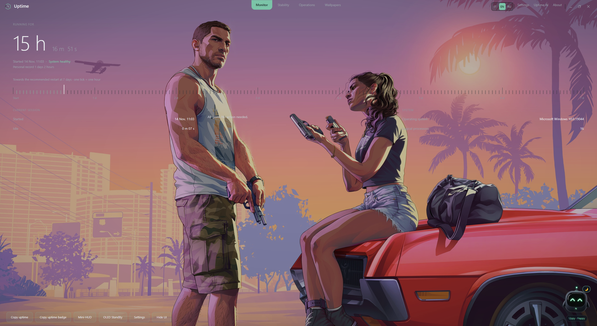
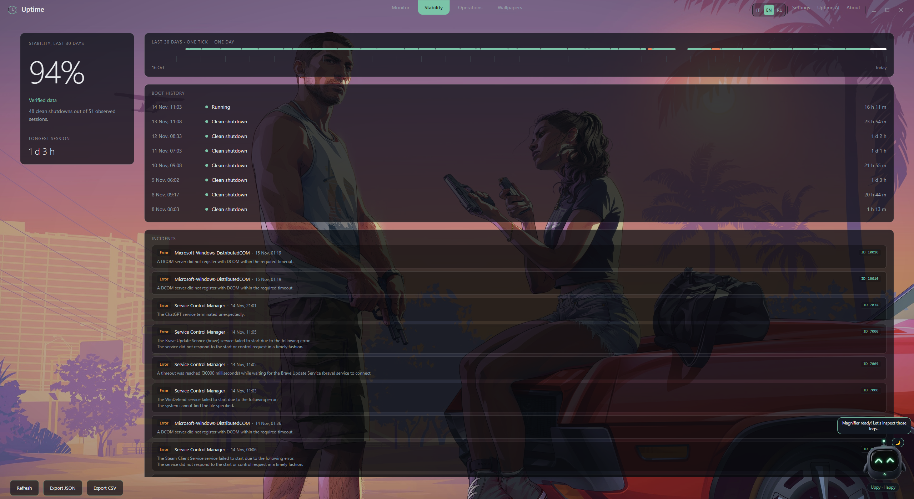
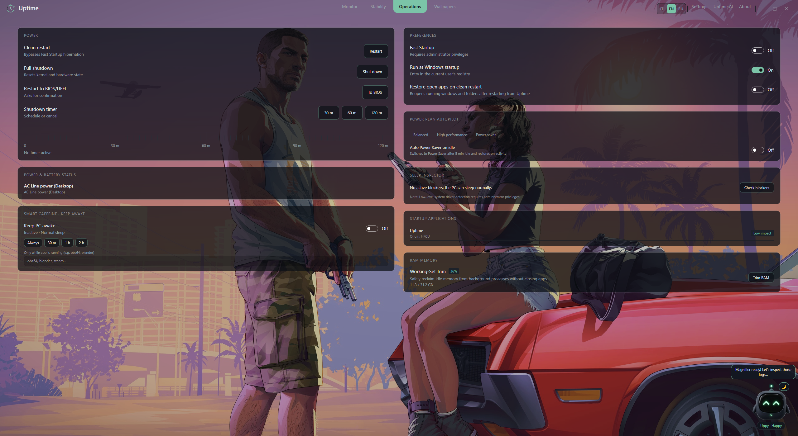
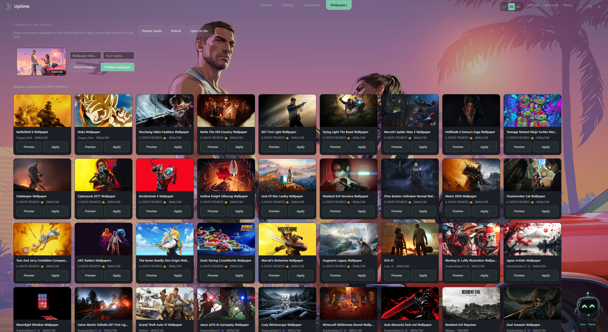
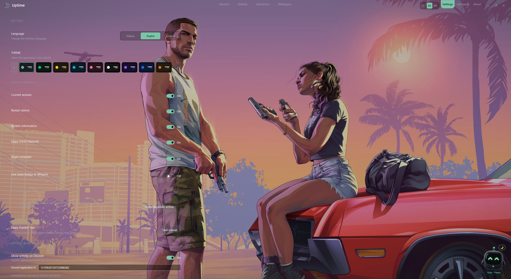
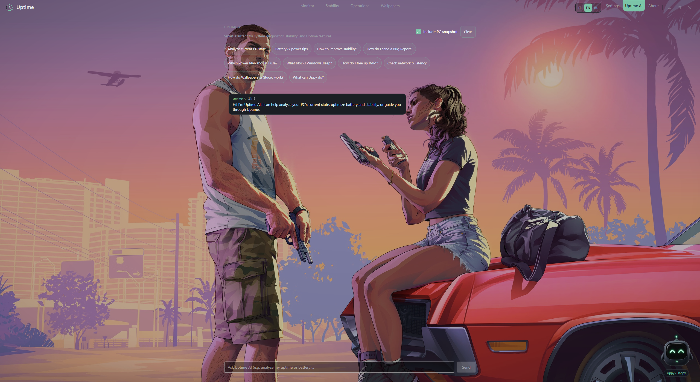
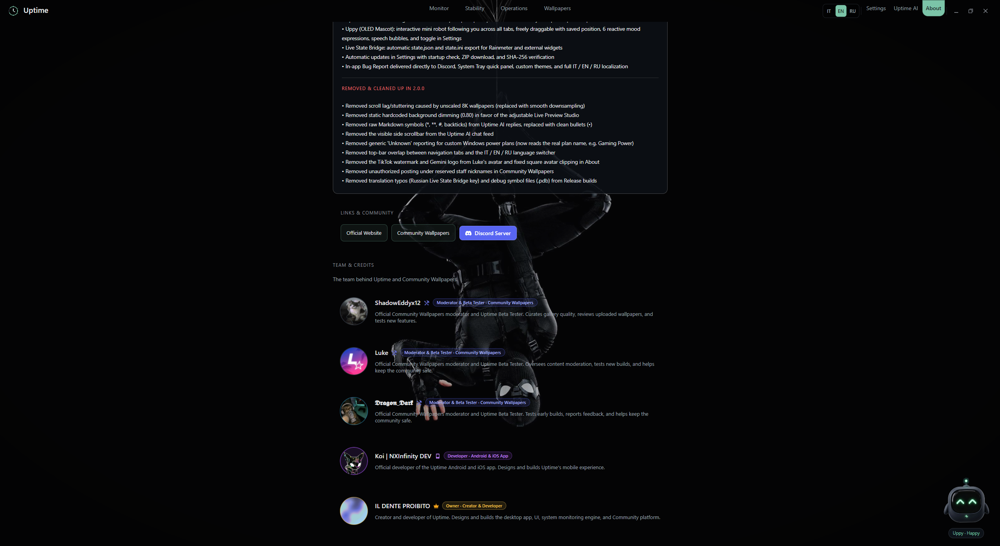

<div align="center">
  
  <h1>Uptime 2.0</h1>
  <p>
    <strong>Windows uptime, stability diagnostics, laptop power intelligence, and OLED Standby in one lightweight desktop app.</strong>
  </p>
  <p>
    <a href="https://apps.microsoft.com/detail/9p7h0nn62hk0?hl=en-GB&gl=EN"></a>
  </p>
  <p>
    <a href="https://uptime-pc.vercel.app/"></a>&nbsp;&nbsp;<a href="https://uptime-pc.vercel.app/wallpapers/"></a>&nbsp;&nbsp;<a href="https://uptime-pc.vercel.app/support/"></a>&nbsp;&nbsp;<a href="https://discord.gg/88qrhwjBDP"></a>&nbsp;&nbsp;
  </p>
</div>

## Screenshots

<table>
  <tr>
    <td align="center" width="33%"><a href="docs/screenshots/monitor.png"></a><br><sub>Monitor</sub></td>
    <td align="center" width="33%"><a href="docs/screenshots/stability.png"></a><br><sub>Stability</sub></td>
    <td align="center" width="33%"><a href="docs/screenshots/operations.png"></a><br><sub>Operations</sub></td>
  </tr>
  <tr>
    <td align="center" width="33%"><a href="docs/screenshots/wallpapers.png"></a><br><sub>Wallpapers</sub></td>
    <td align="center" width="33%"><a href="docs/screenshots/settings.png"></a><br><sub>Settings</sub></td>
    <td align="center" width="33%"><a href="docs/screenshots/uptime-ai.png"></a><br><sub>Uptime AI</sub></td>
  </tr>
</table>

<p align="center">
  <a href="docs/screenshots/about.png"></a><br>
  <sub>About &amp; Team Credits</sub>
</p>

## Features

<table>
  <tr>
    <td width="50%" valign="top">
      <h3>Monitor &amp; Uppy 2.0</h3>
      <ul>
        <li><strong>Live Session Tracking:</strong> real-time boot duration, boot timestamp, personal uptime record, and a 7-day maintenance ruler.</li>
        <li><strong>OLED Standby:</strong> automatic or on-demand burn-in-safe screensaver with 45s pixel-shift, clock, uptime, and battery status.</li>
        <li><strong>Uppy 2.0 Mascot:</strong> interactive companion across all views with 6 reactive moods, speech bubbles, and an optional guided tour.</li>
        <li><strong>Mini-HUD &amp; Spotify Widget:</strong> compact always-on-top HUD and live media/Spotify overlay.</li>
      </ul>
    </td>
    <td width="50%" valign="top">
      <h3>Stability &amp; Crash Radar</h3>
      <ul>
        <li><strong>30-Day Stability Score:</strong> analyzes Windows boot, clean shutdown, and unexpected power-loss events into a visual timeline.</li>
        <li><strong>BSOD &amp; Event Explainer:</strong> translates kernel bugcheck codes and critical System/Application errors into plain language.</li>
        <li><strong>Crash Radar &amp; Network Watchdog:</strong> surfaces recent app hangs/crashes and tracks gateway latency and connection drops.</li>
        <li><strong>One-Click Export:</strong> export full stability reports in JSON or CSV.</li>
      </ul>
    </td>
  </tr>
  <tr>
    <td width="50%" valign="top">
      <h3>Operations &amp; Laptop Intelligence</h3>
      <ul>
        <li><strong>Power Controls:</strong> Clean Restart (bypasses Fast Startup), Full Shutdown, Reboot to UEFI/BIOS, and scheduled shutdown timer.</li>
        <li><strong>Workspace Restore:</strong> optionally saves open apps and Explorer folders before a Clean Restart and restores them on login.</li>
        <li><strong>Smart Caffeine &amp; Power Autopilot:</strong> keeps the PC awake manually, by timer, or by running process (with low-battery guard), and auto-switches power plans on idle.</li>
        <li><strong>Battery, Sleep, Startup &amp; RAM:</strong> inspects battery wear &amp; cycle count, detects sleep blockers, lists startup impact, and safely trims idle RAM working sets.</li>
      </ul>
    </td>
    <td width="50%" valign="top">
      <h3>Wallpapers, Uptime AI &amp; Ecosystem</h3>
      <ul>
        <li><strong>Community Wallpapers &amp; Studio:</strong> browse, preview, publish, and apply community backgrounds with adjustable dimming in Live Preview Studio.</li>
        <li><strong>Uptime AI:</strong> built-in assistant for stability, battery, and power troubleshooting with optional local PC context snapshot.</li>
        <li><strong>Live State Bridge &amp; Rainmeter:</strong> exports live telemetry to <code>state.json</code> / <code>state.ini</code> alongside a Rainmeter skin.</li>
        <li><strong>Polished Desktop Integration:</strong> custom color themes, IT/EN/RU localization, Discord Rich Presence, <code>Win + Alt + U</code> hotkey, tray quick panel, and SHA-256 verified auto-updates.</li>
      </ul>
    </td>
  </tr>
</table>

## Architecture

PC Uptime follows a clean layered architecture separating pure domain logic from Windows APIs, Avalonia UI, and packaging:

| Project | Target | Responsibility |
| --- | --- | --- |
| `Uptime.Core` | `net10.0` | Domain models, stability &amp; uptime analyzers, atomic JSON persistence, localization (`IT` / `EN` / `RU`), and service contracts. |
| `Uptime.Infrastructure` | `net10.0-windows10.0.19041.0` | Win32/WinRT implementations for uptime, idle detection, battery IOCTL, Event Log, power plans, sleep blockers, RAM trim, startup apps, workspace restore, and Community Wallpapers. |
| `Uptime.Presentation` | `net10.0-windows10.0.19041.0` | Avalonia 11.3 desktop UI, MVVM view models (`CommunityToolkit.Mvvm`), Uppy mascot &amp; OLED Standby, tray icon, global hotkeys, Discord RPC, Uptime AI, and SHA-256 updater. |
| `Uptime.Installer` | `net10.0-windows10.0.19041.0` | Self-extracting Windows installer &amp; uninstaller (`UptimeSetup.exe`). |
| `Uptime.Core.Tests` | `net10.0` | Automated xUnit test suite covering persistence, stability analysis, bugcheck explanations, localization, and update validation. |

## Tech Stack

| Layer | Technology |
| --- | --- |
| Language &amp; Runtime | C# 13 / .NET 10 |
| Desktop UI | Avalonia UI 11.3 (Fluent Theme, compiled XAML bindings) |
| Architecture | MVVM (`CommunityToolkit.Mvvm`) + Dependency Injection |
| Windows Integration | Win32 P/Invoke, Device IOCTL, WinRT Power APIs, Windows Event Log |
| Packaging &amp; Hardening | Single-file self-contained `win-x64` + Obfuscar |
| Testing | xUnit (`28` automated tests) |

## Get Started

1. Download **PC Uptime** from the [Microsoft Store](https://apps.microsoft.com/detail/9p7h0nn62hk0?hl=en-GB&gl=EN) or via the official [website](https://uptime-pc.vercel.app/).
2. Launch **Uptime** from the Start menu to open the **Monitor** dashboard.
3. Minimize to the system tray at any time and press `Win` + `Alt` + `U` (or click the tray icon) to toggle the window.

### System Requirements

- **OS:** Windows 10 (version 2004 / build 19041) or Windows 11
- **Architecture:** 64-bit (`x64`)
- **Privacy Note:** Monitoring, Event Log analysis, and system controls run locally on your machine with zero background telemetry.

## Build from Source

### Prerequisites

- Windows 10/11 `x64`
- [.NET 10 SDK](https://dotnet.microsoft.com/download/dotnet/10.0)
- Git

### Restore, Build &amp; Test

```powershell
dotnet restore .\Uptime.slnx
dotnet build .\Uptime.slnx -c Release
dotnet test .\tests\Uptime.Core.Tests\Uptime.Core.Tests.csproj -c Release
```

### Publish Self-Contained `Uptime.exe` &amp; Installer

```powershell
dotnet publish .\src\Uptime.Presentation\Uptime.Presentation.csproj -c Release -r win-x64 --self-contained true -p:PublishSingleFile=true -p:IncludeNativeLibrariesForSelfExtract=true -p:DebugType=none -p:DebugSymbols=false -o .\artifacts\Uptime-Release
powershell -ExecutionPolicy Bypass -File .\build-installer.ps1
```

The single-file executable is generated in `artifacts\Uptime-Release\Uptime.exe` and the setup executable in `artifacts\Uptime-Installer\UptimeSetup.exe`.

## Repository Layout

```text
.
├── docs/
│   ├── screenshots/        # Native 2560x1400 UI screenshots
│   └── Uptime-Logo.png
├── src/
│   ├── Uptime.Core/
│   ├── Uptime.Infrastructure/
│   ├── Uptime.Presentation/
│   └── Uptime.Installer/
├── tests/
│   └── Uptime.Core.Tests/
├── trailer/                # Remotion source for the Uppy 2.0 trailer
├── build-installer.ps1
└── Uptime.slnx
```

## Privacy &amp; Support

PC Uptime processes system uptime, Event Log history, and power diagnostics locally on your PC. External requests only occur when you explicitly open Community Wallpapers, ask Uptime AI, check for updates, or submit an in-app bug report. Read the [Privacy Policy &amp; Terms](https://uptime-pc.vercel.app/privacy/) for full details.

- **Help Center:** [uptime-pc.vercel.app/support](https://uptime-pc.vercel.app/support/)
- **Community:** [Uptime Discord Server](https://discord.gg/88qrhwjBDP)
- **Issues:** [GitHub Issues](https://github.com/ildenteproibito/PC-Uptime/issues)

## License

All rights reserved. The source code is published for transparency and review; it is not licensed for redistribution or commercial use.

Maintained by [@ildenteproibito](https://github.com/ildenteproibito).
