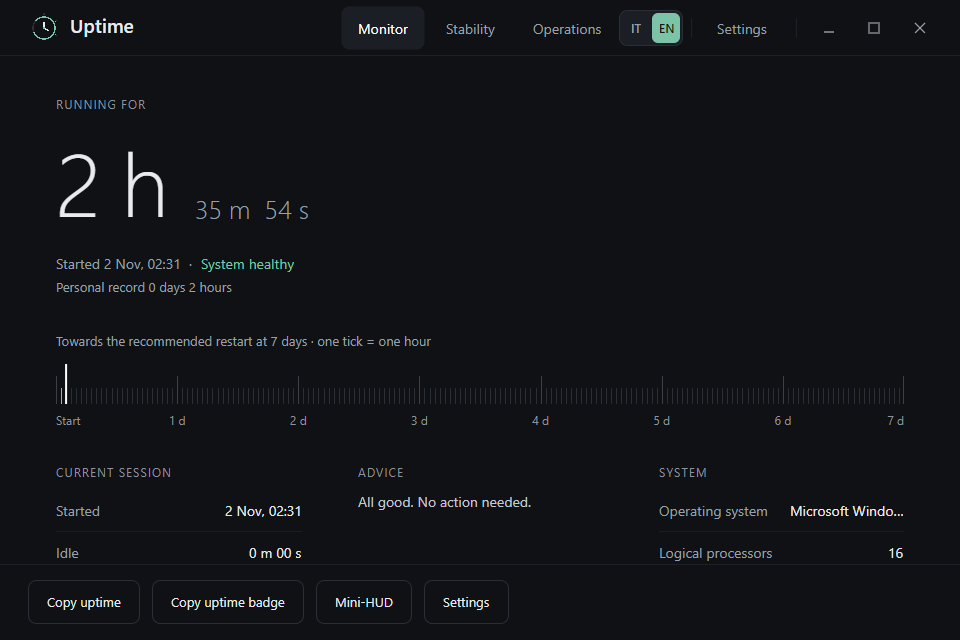
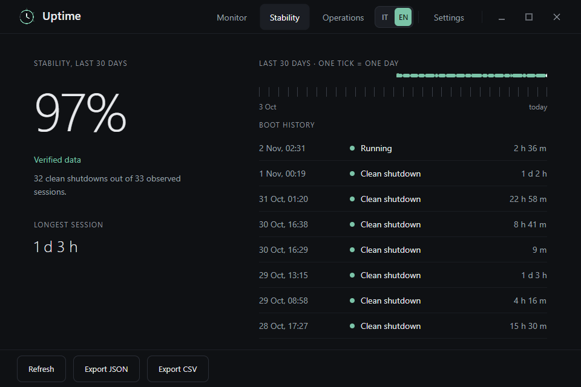
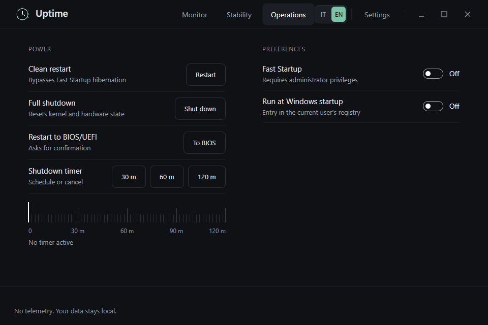

# PC Uptime

See how long your PC has been running, review recent sessions, and understand unexpected shutdowns from one quiet Windows app.

**PC Uptime** is an independent desktop project for Windows. It keeps monitoring data on your computer and presents uptime, stability, and system activity in a clear dashboard.

<p align="center">
  
</p>

<p align="center">
  <a href="https://apps.microsoft.com/detail/9p7h0nn62hk0?hl=en-EN&amp;gl=EN"><strong>Get it from Microsoft Store</strong></a>
  &nbsp;·&nbsp; <a href="https://uptime-pc.vercel.app/">Website</a>
  &nbsp;·&nbsp; <a href="https://uptime-pc.vercel.app/support/">Help and support</a>
  &nbsp;·&nbsp; <a href="https://discord.gg/88qrhwjBDP">Discord</a>
</p>

## Screenshots

The screenshots below show the app’s Monitor, Stability, and Operations views.

<table>
  <tr>
    <td align="center" width="33%"><a href="docs/screenshots/monitor.png"></a><br><sub>Monitor</sub></td>
    <td align="center" width="33%"><a href="docs/screenshots/stability.png"></a><br><sub>Stability</sub></td>
    <td align="center" width="33%"><a href="docs/screenshots/operations.png"></a><br><sub>Operations</sub></td>
  </tr>
</table>

## What it does

- **Tracks uptime** from the current Windows boot and shows when the session began.
- **Keeps session history** with durations and active or idle time.
- **Reviews stability** using Windows startup and shutdown events, with incident details for unexpected shutdowns.
- **Shows system information** alongside the current session and a restart recommendation.
- **Puts uptime within reach** through the notification-area icon, a global shortcut (`Win` + `Alt` + `U`), and the compact Mini-HUD.
- **Provides power tools** for a clean restart, full shutdown, restart to UEFI/BIOS, and timed shutdown.
- **Exports records** as JSON or CSV and creates shareable uptime badges.
- **Offers preferences** for startup behavior, Fast Startup, dashboard layout, language, and the optional night reminder.

## Get started

Install PC Uptime from the [Microsoft Store](https://apps.microsoft.com/detail/9p7h0nn62hk0?hl=en-EN&gl=EN), then open it from the Start menu. The Monitor, Stability, and Operations tabs provide the main dashboard, history, and system controls. Use the tray icon or `Win` + `Alt` + `U` to bring the app back when it is minimized.

For usage help and troubleshooting, visit the [support page](https://uptime-pc.vercel.app/support/). You can also ask questions in the [Uptime Discord server](https://discord.gg/88qrhwjBDP).

## System requirements

- Windows 10 (version 2004 / build 19041) or later
- 64-bit (x64) Windows
- Internet access is needed to download or install the app; monitoring runs locally

## Build from source

The checked-in desktop app uses C#, WPF, and .NET 8. To build it, install the [.NET 8 SDK](https://dotnet.microsoft.com/download/dotnet/8.0) and run these commands from the repository root in PowerShell:

```powershell
dotnet restore .\Uptime.csproj
dotnet build .\Uptime.csproj --configuration Release
```

To run the test suite:

```powershell
dotnet test .\tests\Uptime.Tests\Uptime.Tests.csproj --configuration Release
```

## How it is organized

| Path | Contents |
| --- | --- |
| `Uptime/` | WPF application, dashboard, Mini-HUD, tray integration, and views |
| `UptimeHelper.cs` | Uptime and boot-time helpers |
| `SystemMetricsTracker.cs` | Session activity, stability information, and system metrics |
| `ExportHelper.cs` | JSON and CSV export |
| `LocalizationEngine.cs` / `LanguageProfile.cs` | Interface text and localized formatting |
| `tests/Uptime.Tests/` | MSTest test suite |
| `docs/screenshots/` | Screenshots used in this README |

## Privacy

PC Uptime reads Windows system information and event history to show uptime and stability. Monitoring records and event details are processed locally; the app does not send telemetry. You control any exported records and should review them before choosing to share them.

Read the [Privacy Policy and Terms of Service](https://uptime-pc.vercel.app/privacy/) for details about the app and website.

## Project status

PC Uptime is an independent project maintained in the open. The repository reflects the available source; Microsoft Store is the recommended way to install the published app. Follow the [website](https://uptime-pc.vercel.app/) or [Discord](https://discord.gg/88qrhwjBDP) for project updates. To report a problem, open a [GitHub issue](https://github.com/ildenteproibito/PC-Uptime/issues).

## License

All rights reserved. The source is published for transparency and review; it is not licensed for redistribution or commercial use.

Maintained by [@ildenteproibito](https://github.com/ildenteproibito).
